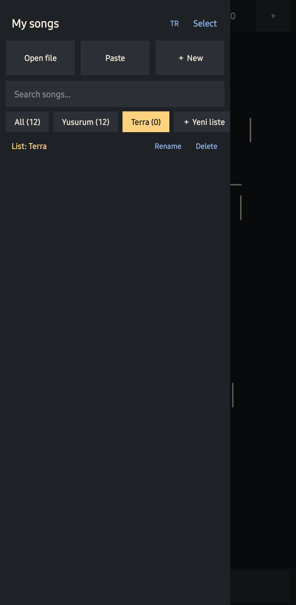
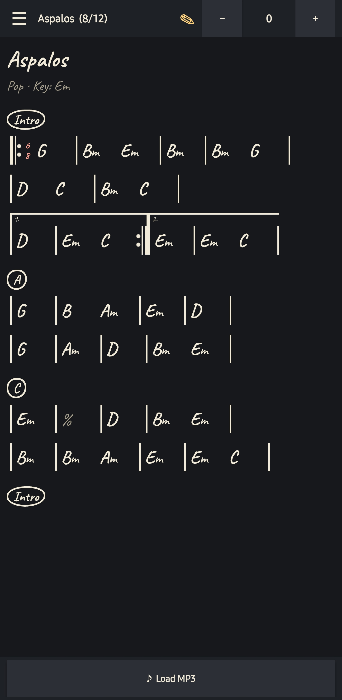
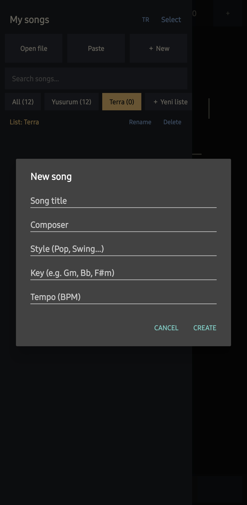
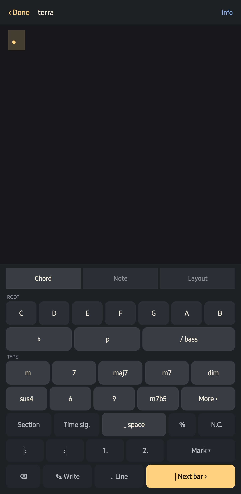
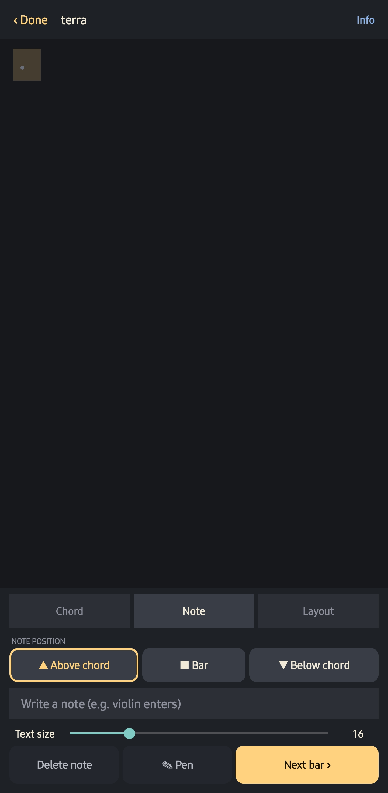
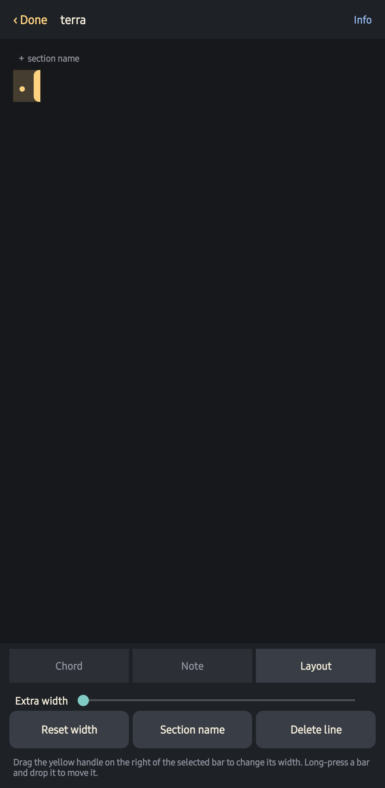

## Screenshots

<p align="center">
  
  
  
</p>
<p align="center">
  
  
  
</p>

# Clef

**English** · [Türkçe](#türkçe)

A small chord-chart notebook. It runs in the browser, installs on an iPhone like an app, and also comes as an Android app. Write songs from scratch, import iReal Pro charts, transpose, and export.

**Open:** https://ozzydeveci.github.io/clef/

## How it works

1. **Install (iPhone):** open the link in Safari → Share → *Add to Home Screen*. It then opens full screen and works offline.
2. **Add songs:** in the ☰ menu use **＋ New** to write a song, **Open file** to load a `.clef` file, or **Paste** to import an `irealb://` link. iReal charts are converted to Clef's format on import.
3. **Write chords:** open a song and tap ✎. In the **Chord** tab pick a root note, then a type (m, 7, maj7…). Every cell is one beat: **␣** adds a beat, so `Dm7 ␣ G7 ␣` gives each chord two beats. **| Next bar** inserts a new bar, **↵ Line** starts a new line. A bar can have a time signature (4/4, 5/8, 7/8, 9/8…), repeat signs (`|:` `:|`), 1st/2nd endings, and marks (Segno, Coda, D.C.…).
4. **Notes:** in the **Note** tab add red notes above or below the chords, or a note inside the bar. Font size is adjustable.
5. **Layout:** in the **Layout** tab adjust bar width with the slider or the yellow handle. Long-press a bar and drag to move it, even to another line.
6. **Play along:** transpose with − / +, swipe left/right to change songs, attach an MP3 to a song.
7. **Export:** *Clef file* (`.clef`, also works with the Android app) or *PDF* (print dialog → Save as PDF).

Your songs are stored **on your device only** (no server, no account). Clear Safari data and they are gone, so export a `.clef` backup now and then.

Not included in the web version: handwriting recognition (available in the [Android app](#android-app)).

## Android app

The Android version has everything above plus **handwriting recognition** (write a chord with a pen or finger, pick from suggestions).

**Install:**
1. On your phone, open the [latest release](https://github.com/ozzydeveci/clef/releases/latest) and download **Clef.apk**.
2. Open the downloaded file. If Android asks, allow installs from this source (Settings → *Install unknown apps* → your browser or Files app).
3. Tap **Install**. If Play Protect warns that the app is unrecognized, choose *Install anyway*: the APK is signed with a debug key, not a Play Store key.
4. The first time you use handwriting, the recognition model (a few MB) is downloaded once, so you need internet for that moment.

Language: the app is available in English and Turkish. It follows the phone language (Turkish if the phone is Turkish, English otherwise); tap **EN / TR** at the top of the left menu to switch manually.

Notes: arm64 phones only (most phones from the last several years). Songs are stored on the device; export a `.clef` file to back up or move them to the web version.

## Run locally

```
python3 -m http.server 8000
```

Then open `http://localhost:8000`. No build step.

---

## Türkçe

Küçük bir akor şarkı defteri. Tarayıcıda çalışır, iPhone'a uygulama gibi kurulur ve Android uygulaması olarak da var. Şarkıları sıfırdan yazabilir, iReal Pro şarkılarını içe aktarabilir, transpoze edebilir ve dışa aktarabilirsin.

**Aç:** https://ozzydeveci.github.io/clef/

### Nasıl çalışır

1. **Kurulum (iPhone):** bağlantıyı Safari'de aç → Paylaş → *Ana Ekrana Ekle*. Sonra tam ekran açılır ve internetsiz çalışır.
2. **Şarkı ekleme:** ☰ menüsünde **＋ Yeni** ile şarkı yaz, **Dosya aç** ile `.clef` dosyası yükle ya da **Yapıştır** ile `irealb://` bağlantısı al. iReal şarkıları içe aktarılırken Clef biçimine çevrilir.
3. **Akor yazma:** şarkıyı aç, ✎'e dokun. **Akor** sekmesinde önce kök notayı, sonra türü (m, 7, maj7…) seç. Her hücre bir vuruştur: **␣** bir vuruş ekler, yani `Dm7 ␣ G7 ␣` her akora iki vuruş verir. **| Sonraki ölçü** araya yeni ölçü açar, **↵ Satır** yeni satır başlatır. Ölçüye usül (4/4, 5/8, 7/8, 9/8…), tekrar işaretleri (`|:` `:|`), 1./2. bitiş ve işaretler (Segno, Coda, D.C.…) eklenebilir.
4. **Notlar:** **Not** sekmesinde akorların üstüne ya da altına kırmızı not, ölçünün içine de not yazabilirsin. Yazı boyutu ayarlanır.
5. **Düzen:** **Düzen** sekmesinde ölçü genişliğini kaydırıcıyla ya da sarı tutamaçla ayarla. Ölçüye uzun basıp sürükleyerek başka yere, başka satıra da taşıyabilirsin.
6. **Çalarken:** − / + ile transpoze et, sola/sağa kaydırarak şarkı değiştir, şarkıya MP3 bağla.
7. **Dışa aktarma:** *Clef dosyası* (`.clef`, Android uygulamasıyla da uyumlu) ya da *PDF* (yazdırma ekranı → PDF olarak kaydet).

Şarkıların **yalnızca cihazında** saklanır (sunucu ve hesap yok). Safari verisini silersen şarkılar da gider, bu yüzden arada bir `.clef` yedeği al.

Web sürümünde olmayan: el yazısı tanıma (Android uygulamasında var, kurulum için [aşağıya](#android-uygulaması) bak).

### Android uygulaması

Android sürümünde yukarıdakilerin hepsine ek olarak **el yazısı tanıma** var (akoru kalemle ya da parmakla yaz, önerilerden birini seç).

**Kurulum:**
1. Telefonda [son sürüm sayfasını](https://github.com/ozzydeveci/clef/releases/latest) aç ve **Clef.apk** dosyasını indir.
2. İndirdiğin dosyayı aç. Android sorarsa bu kaynaktan kuruluma izin ver (Ayarlar → *Bilinmeyen uygulamaları yükle* → tarayıcın ya da Dosyalar uygulaması).
3. **Yükle**'ye dokun. Play Protect "tanınmayan uygulama" uyarısı verirse *Yine de yükle*'yi seç: APK, Play Store anahtarıyla değil, hata ayıklama anahtarıyla imzalı.
4. El yazısını ilk kullanışında tanıma modeli (birkaç MB) bir kez indirilir, o an internet gerekir.

Dil: uygulama Türkçe ve İngilizce sunar. Telefon dilini izler (telefon Türkçeyse Türkçe, değilse İngilizce); elle değiştirmek için sol menünün üstündeki **EN / TR**'ye dokun.

Notlar: yalnızca arm64 telefonlar (son yılların çoğu telefonu). Şarkılar cihazda saklanır; yedeklemek ya da web sürümüne taşımak için `.clef` dosyası dışa aktar.

### Yerelde çalıştırma

```
python3 -m http.server 8000
```

Sonra `http://localhost:8000` adresini aç. Derleme adımı yok.
